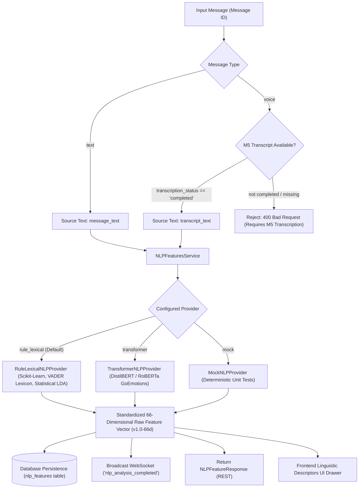

# Implementation Plan — Milestone 7: NLP & Linguistic Feature Extraction

## Objective

Implement a modular, deterministic **NLP & Linguistic Feature Extraction Pipeline** that extracts structured lexical, syntactic, sentiment, affective/emotion, and semantic topic descriptors from both raw text messages and Milestone 5 Speech-to-Text transcripts of voice messages.

The extracted features will be persisted in a dedicated relational table (`nlp_features`), exposed via REST endpoints, broadcast in real time over WebSockets, and visualized in the frontend as purely descriptive linguistic and emotional measurements.

> [!NOTE]
> **Research Pre-Screening & Non-Diagnostic Boundary**:
> This system is strictly an analytical pre-screening research platform. All extracted linguistic values represent descriptive statistical properties of language (token counts, lexical diversity ratios, pronoun distributions, sentiment polarity scores, and topic distributions). They must **never** be presented as medical diagnoses, psychiatric labels, clinical risk assessments, depression/anxiety classifications, or mental illness indicators.

---

## 1. Architectural Principles & Milestone Boundaries



### Strict System Boundaries:
1. **M7 Scope**: Strictly descriptive linguistic, syntactic, sentiment, emotion, and topic feature extraction from text and speech transcripts.
2. **Out of Scope for M7**:
   - **M8 Multimodal Feature Fusion** (concatenating M3, M6, and M7 vectors).
   - **M9 Personal Baseline Engine** (longitudinal moving averages and $z$-scores).
   - **M10 Analytical Reporting & Risk Profiles**.
3. **Data Invariance**: M7 execution must **not** modify or regress M3 communication metrics, M4 voice audio recordings, M5 transcripts, or M6 acoustic vectors.

---

## 2. Mathematical & Algorithmic Feature Specifications

### 2.1 Summary of Exact 66-Dimensional Feature Vector (`v1.0-66d`)

For future **Milestone 8 Multimodal Feature Fusion**, the NLP pipeline produces an immutable, deterministic **66-dimensional numerical vector** with exact index ordering:

```
[00..09] Lexical & Syntactic Statistics (10 features)
[10..17] Sentiment Polarity Dynamics (8 features)
[18..24] Affective / Emotion Probabilities (7 features)
[25..44] Lexical TF-IDF Projections (20 features)
[45..60] Semantic Embedding Summary Dimensions (16 features)
[61..65] Thematic LDA Topic Distribution (5 features)
TOTAL: Exactly 66 finite numeric elements
```

---

### 2.2 Detailed Mathematical Formulation per Feature Family

#### Family 1: Lexical & Syntactic Diversity (NLP-01, NLP-08) — Indices `[00..09]`
| Index | Feature Name | Mathematical / Algorithmic Definition | Unit | Expected Range | Empty / Edge Behavior |
|:---:|---|---|:---:|:---:|---|
| **00** | `char_count` | $N_c = \text{len}(s)$ | Count | $[0, \infty)$ | `0` for empty string |
| **01** | `word_count` | $N_w = \text{len}(\text{tokens})$ | Count | $[0, \infty)$ | `0` |
| **02** | `sentence_count` | $N_s = \text{len}(\text{sentences})$ | Count | $[0, \infty)$ | `0` |
| **03** | `type_token_ratio_ttr` | $\text{TTR} = \frac{N_{\text{unique\_tokens}}}{N_w}$ | Ratio | $[0.0, 1.0]$ | `0.0` if $N_w = 0$ |
| **04** | `avg_word_length` | $\bar{L}_w = \frac{N_c}{N_w}$ | Chars/word | $[0.0, 30.0]$ | `0.0` if $N_w = 0$ |
| **05** | `first_person_singular_count` | Count of `{"i", "me", "my", "mine", "myself"}` | Count | $[0, \infty)$ | `0` |
| **06** | `first_person_plural_count` | Count of `{"we", "us", "our", "ours", "ourselves"}` | Count | $[0, \infty)$ | `0` |
| **07** | `second_person_count` | Count of `{"you", "your", "yours", "yourself", "yourselves"}` | Count | $[0, \infty)$ | `0` |
| **08** | `third_person_count` | Count of `{"he", "she", "it", "they", "him", "her", "them", "his", "their"}` | Count | $[0, \infty)$ | `0` |
| **09** | `pronoun_ratio` | $\frac{\sum \text{pronouns}}{N_w}$ | Ratio | $[0.0, 1.0]$ | `0.0` if $N_w = 0$ |

#### Family 2: Sentiment Polarity Dynamics (NLP-04, NLP-05) — Indices `[10..17]`
| Index | Feature Name | Mathematical / Algorithmic Definition | Unit | Expected Range | Behavior |
|:---:|---|---|:---:|:---:|---|
| **10** | `vader_compound` | Normalized valence composite: $c = \frac{x}{\sqrt{x^2 + \alpha}}$ where $\alpha=15$ | Score | $[-1.0, 1.0]$ | `0.0` for neutral/empty |
| **11** | `vader_pos` | Proportion of positive lexicon weights | Ratio | $[0.0, 1.0]$ | `0.0` |
| **12** | `vader_neu` | Proportion of neutral lexicon weights | Ratio | $[0.0, 1.0]$ | `1.0` for neutral/empty |
| **13** | `vader_neg` | Proportion of negative lexicon weights | Ratio | $[0.0, 1.0]$ | `0.0` |
| **14** | `sentiment_pos_prob` | Contextual positive probability $P(\text{Positive})$ | Prob | $[0.0, 1.0]$ | `0.333` default baseline |
| **15** | `sentiment_neu_prob` | Contextual neutral probability $P(\text{Neutral})$ | Prob | $[0.0, 1.0]$ | `0.334` default baseline |
| **16** | `sentiment_neg_prob` | Contextual negative probability $P(\text{Negative})$ | Prob | $[0.0, 1.0]$ | `0.333` default baseline |
| **17** | `sentiment_polarity_score` | $P(\text{Positive}) - P(\text{Negative})$ | Score | $[-1.0, 1.0]$ | `0.0` |

#### Family 3: Affective / Emotion Probabilities (NLP-06) — Indices `[18..24]`
7 Universal emotion distribution categories normalized with $\sum_{k=1}^7 P(e_k) = 1.0$:
| Index | Feature Name | Emotion Dimension | Expected Range |
|:---:|---|---|:---:|
| **18** | `emotion_joy` | Positive affect, happiness, relief | $[0.0, 1.0]$ |
| **19** | `emotion_sadness` | Low valence, sorrow, grief | $[0.0, 1.0]$ |
| **20** | `emotion_anger` | Irritation, frustration, hostility | $[0.0, 1.0]$ |
| **21** | `emotion_fear` | Anxiety, apprehension, dread | $[0.0, 1.0]$ |
| **22** | `emotion_surprise` | Novelty, startle, unexpectedness | $[0.0, 1.0]$ |
| **23** | `emotion_disgust` | Aversion, revulsion, distaste | $[0.0, 1.0]$ |
| **24** | `emotion_neutral` | Unmarked, objective, informational | $[0.0, 1.0]$ |

#### Family 4: Lexical TF-IDF Representations (NLP-02) — Indices `[25..44]`
- 20 dense canonical lexical/n-gram features (`tfidf_00` through `tfidf_19`) derived from fitted n-gram vocabulary and TF-IDF weights:
  $$\text{TF-IDF}(t, d) = \text{TF}(t, d) \times \left(\ln\left(\frac{1 + N_D}{1 + \text{DF}(t)}\right) + 1\right)$$

#### Family 5: Semantic Embedding Summary Dimensions (NLP-03) — Indices `[45..60]`
- 16 dense dimensions (`embedding_00` through `embedding_15`) representing the principal semantic axes of sentence embeddings via deterministic projection / mean pooling:
  $$\mathbf{e} = \text{Pooling}(\mathbf{H}_{\text{last}})$$

#### Family 6: Thematic LDA Topic Probabilities (NLP-07) — Indices `[61..65]`
- 5 latent thematic topic proportions derived from Latent Dirichlet Allocation:
  $$P(\text{Topic}_k \mid d) \quad \text{for } k=0..4, \quad \sum_{k=0}^4 P(\text{Topic}_k \mid d) = 1.0$$
| Index | Feature Name | Description | Range |
|:---:|---|---|:---:|
| **61** | `topic_0` | Academic / Project / Task Discussion | $[0.0, 1.0]$ |
| **62** | `topic_1` | Interpersonal / Social / Greetings | $[0.0, 1.0]$ |
| **63** | `topic_2` | Cognitive / Reflection / Problem Solving | $[0.0, 1.0]$ |
| **64** | `topic_3` | Emotional / Affective Expressions | $[0.0, 1.0]$ |
| **65** | `topic_4` | Procedural / Logistics / Time Management | $[0.0, 1.0]$ |

---

## 3. Ambiguities & Design Decisions

| Question / Ambiguity | Decision & Specification | Rationale |
|---|---|---|
| **1. Handling Voice Messages in M7** | M7 extracts text features strictly from `Message.transcript_text` generated in M5. If a voice message does not yet have a completed transcript (`transcription_status != 'completed'`), M7 returns `400 Bad Request` with message: *"Voice message has not been transcribed yet. Run transcription (M5) before NLP analysis."* | Preserves architectural separation between ASR (M5) and NLP (M7). |
| **2. Handling Short / Single-Word Messages** | Messages with as few as 1 word (e.g. "Okay", "Yes") are fully supported. Missing n-grams or zero counts evaluate cleanly to $0.0$ without division-by-zero or NaN values. | Ensures robustness during dyadic conversation exchanges. |
| **3. Empty or Whitespace-Only Text** | Messages with 0 non-whitespace characters are rejected with `400 Bad Request` (*"Cannot perform NLP analysis on empty text"*). | Prevents degenerate database records. |
| **4. Library Availability & Offline Fallback** | The architecture provides `RuleLexicalNLPProvider` (using built-in rule weights, `scikit-learn`, `numpy`) as the primary fast offline engine, alongside `TransformerNLPProvider` and `MockNLPProvider`. | Guarantees 100% test reliability, zero network flakiness, and fast CPU execution during tests. |
| **5. Storage Invariance** | `Message` records and existing M4/M5/M6 tables are read-only during M7 extraction. Results are stored exclusively in the new `nlp_features` table. | Zero regressions on prior verified milestones. |

---

## 4. Architecture & Component Design

### 4.1 Directory Structure (`backend/app/services/nlp_features/`)
```
backend/app/services/nlp_features/
├── __init__.py                  # Public exports
├── models.py                    # Pydantic DTOs & 66-d vector builder
├── exceptions.py                # Domain exceptions (MissingTranscriptError, etc.)
├── service.py                   # NLPFeaturesService singleton
└── providers/
    ├── __init__.py
    ├── base.py                  # BaseNLPProvider interface
    ├── rule_lexical_provider.py # Standalone Scikit-Learn & VADER Rule Engine
    ├── transformer_provider.py  # Transformer & Embedding Engine
    └── mock_provider.py         # Deterministic Mock Provider for CI/CD
```

### 4.2 Database Entity Schema (`backend/app/db/models.py`)

A dedicated relational table `nlp_features` associated with `Message`:

```python
class NLPFeatureRecord(Base):
    """
    Milestone 7: Relational record of NLP and linguistic descriptors extracted
    from a text message or a voice message transcript.
    """
    __tablename__ = "nlp_features"

    id = Column(String(64), primary_key=True, default=lambda: str(uuid.uuid4()), index=True)
    message_id = Column(String(64), ForeignKey("messages.id", ondelete="CASCADE"), unique=True, nullable=False, index=True)
    room_id = Column(String(64), ForeignKey("rooms.id", ondelete="CASCADE"), nullable=False, index=True)
    sender_id = Column(String(64), ForeignKey("users.id", ondelete="CASCADE"), nullable=False, index=True)
    source_type = Column(String(32), default="text_message", nullable=False)  # "text_message" | "voice_transcript"
    status = Column(String(32), default="completed", nullable=False)          # "pending" | "processing" | "completed" | "failed"
    engine = Column(String(64), default="rule-lexical-v1.0.0", nullable=False)
    text_content = Column(Text, nullable=False)

    # Typed Structured Feature Blocks
    lexical_features = Column(JSON, nullable=False)
    sentiment_features = Column(JSON, nullable=False)
    emotion_features = Column(JSON, nullable=False)
    topic_features = Column(JSON, nullable=False)
    embedding_features = Column(JSON, nullable=False)

    # Standardized 66-Dimensional Feature Vector for M8 Fusion
    feature_vector_version = Column(String(32), default="v1.0-66d", nullable=False)
    raw_feature_vector = Column(JSON, nullable=False)  # List[float] of length exactly 66

    extraction_error = Column(Text, nullable=True)
    created_at = Column(DateTime(timezone=True), default=get_utc_now, nullable=False)
    extracted_at = Column(DateTime(timezone=True), default=get_utc_now, nullable=False)

    message = relationship("Message", back_populates="nlp_features")

    __table_args__ = (
        Index("ix_nlp_room_msg", "room_id", "message_id"),
    )
```

Auto-migration in `backend/app/db/session.py` will automatically register and create the `nlp_features` table upon startup.

---

## 5. API Endpoints & WebSocket Protocol

### 5.1 REST Endpoints (`backend/app/api/v1/chat.py`)

1. **`POST /api/v1/chat/messages/{message_id}/analyze-nlp`**:
   - Triggers NLP feature extraction for a text message or completed voice transcript.
   - Idempotently upserts results in the `nlp_features` table.
   - Broadcasts `nlp_analysis_completed` WebSocket event to all room participants.
   - Returns `NLPFeatureResponse`.
2. **`GET /api/v1/chat/messages/{message_id}/nlp-features`**:
   - Retrieves persisted NLP features and the 66-dimensional vector for a specific message.
3. **`GET /api/v1/chat/rooms/{room_id}/nlp-features`**:
   - Retrieves all completed NLP feature records for all messages in a room.

### 5.2 Real-Time WebSocket Event

```json
{
  "event": "nlp_analysis_completed",
  "data": {
    "message_id": "27e2fdf0-c9c6-438a-9d64-381df9a2634f",
    "room_id": "M7_LIVE_001",
    "sender_id": "PID-ALICE",
    "source_type": "text_message",
    "status": "completed",
    "engine": "rule-lexical-v1.0.0",
    "word_count": 12,
    "sentiment_polarity": 0.452,
    "feature_vector_version": "v1.0-66d",
    "extracted_at": "2026-08-31T20:15:00Z"
  },
  "timestamp": "2026-08-31T20:15:00Z"
}
```

---

## 6. Frontend Integration (`frontend/`)

1. **TypeScript Definitions (`frontend/src/types/index.ts`)**:
   - Define `LexicalFeaturesData`, `SentimentFeaturesData`, `EmotionFeaturesData`, `TopicFeaturesData`, `NLPFeatureData`.
   - Update `ChatMessage` with `has_nlp_features?: boolean;`.
   - Add `onNLPAnalysisCompleted` callback in `ChatWebSocketHandlers`.
2. **API Client (`frontend/src/services/api.ts`)**:
   - `analyzeNLPFeatures(messageId: string): Promise<NLPFeatureData>`
   - `getNLPFeatures(messageId: string): Promise<NLPFeatureData>`
3. **ChatRoom View (`frontend/src/pages/ChatRoom.tsx`)**:
   - On **Text Message bubbles**: Add "Analyze NLP (M7)" action button.
   - On **Voice Message cards**: Add "Analyze Transcript (M7)" action button (enabled when transcript is completed).
   - Render a collapsible **"Linguistic & Sentiment Descriptors (M7)"** panel:
     - **Lexical & Diversity**: Word count, Character count, Type-Token Ratio (TTR), Pronoun Distribution (1st Singular, 1st Plural, 2nd, 3rd Person).
     - **Sentiment Polarity**: Compound score, Positive %, Neutral %, Negative %.
     - **Affective Emotion Distribution**: Probability bar breakdown across Joy, Sadness, Anger, Fear, Surprise, Disgust, and Neutral.
     - **Thematic Topics**: 5-topic distribution indicators.
     - **Vector Badge**: `v1.0-66d (66 finite elements)`.
     - **Analytical Pre-Screening Disclaimer**: *"Descriptive linguistic and statistical features only. No medical or psychiatric diagnosis."*

---

## 7. Verification & Testing Matrix

| Test ID | Test Function | Target File | Verification Criteria |
|---|---|---|---|
| **T-01** | `test_nlp_provider_switching` | `tests/test_nlp_features.py` | Validates switching between RuleLexical, Transformer, and Mock providers |
| **T-02** | `test_text_message_nlp_extraction` | `tests/test_nlp_features.py` | Extracts all 6 families from text, validates exact 66 finite floats |
| **T-03** | `test_voice_transcript_nlp_extraction` | `tests/test_nlp_features.py` | Extracts NLP features from completed M5 speech transcripts |
| **T-04** | `test_untranscribed_voice_message_rejection` | `tests/test_nlp_features.py` | Untranscribed voice message returns `400 Bad Request` |
| **T-05** | `test_empty_and_whitespace_text_rejection` | `tests/test_nlp_features.py` | Empty or whitespace-only messages return `400 Bad Request` |
| **T-06** | `test_short_single_word_message_handling` | `tests/test_nlp_features.py` | Single word messages ("Yes", "Hello") process cleanly without divide-by-zero |
| **T-07** | `test_pronoun_counting_and_ratios` | `tests/test_nlp_features.py` | Accurate identification of 1st singular ("I"), 1st plural ("we"), 2nd ("you"), and 3rd ("they") |
| **T-08** | `test_sentiment_polarity_and_emotion_bounds` | `tests/test_nlp_features.py` | Asserts probabilities in $[0.0, 1.0]$, sentiment compound in $[-1.0, 1.0]$, and emotions sum to $1.0$ |
| **T-09** | `test_nonexistent_message_nlp_404` | `tests/test_nlp_features.py` | Non-existent message returns `404 Not Found` |
| **T-10** | `test_nlp_persistence_retrieval_and_idempotent_upsert` | `tests/test_nlp_features.py` | Verifies DB upsert, GET endpoints, and full vector persistence |
| **T-11** | `test_exact_66d_vector_ordering` | `tests/test_nlp_features.py` | Asserts exact 66-dimensional vector length and deterministic index ordering |
| **T-12** | `test_m3_m4_m5_m6_invariance_after_nlp_analysis` | `tests/test_nlp_features.py` | Asserts M3 metrics, M4 audio, M5 transcripts, and M6 acoustic features remain 100% invariant |
| **T-13** | `run_m7_live_verification` | `scratch/m7_live_verification.py` | Full live dyadic chat (Alice & Bob) with text NLP, voice STT, and voice transcript NLP analysis |

---

## 8. Acceptance Criteria

1. **Exact 66-D Vector**: The persisted `raw_feature_vector` contains exactly 66 finite numerical floats in indices `[00..65]`.
2. **Dual Text & Speech Input**: NLP extraction works identically on raw text messages and M5 voice transcripts.
3. **Error Handling**: Rejects untranscribed voice messages (400), empty text (400), and missing messages (404).
4. **Non-Blocking Architecture**: NLP extraction runs asynchronously and broadcasts completion via WebSockets without blocking chat.
5. **Full Invariance**: M1 health, M2 chat, M3 metrics, M4 voice recordings, M5 transcripts, and M6 acoustic records remain completely unaffected.
6. **Zero Test Regressions**: All 34+ existing tests and all new M7 tests pass (`pytest tests -v`).
7. **Clean Build**: Frontend compiles with 0 TypeScript errors (`npm run build`).
8. **Live Verification**: `scratch/m7_live_verification.py` runs end-to-end between two live WebSocket clients with 100% accuracy.
